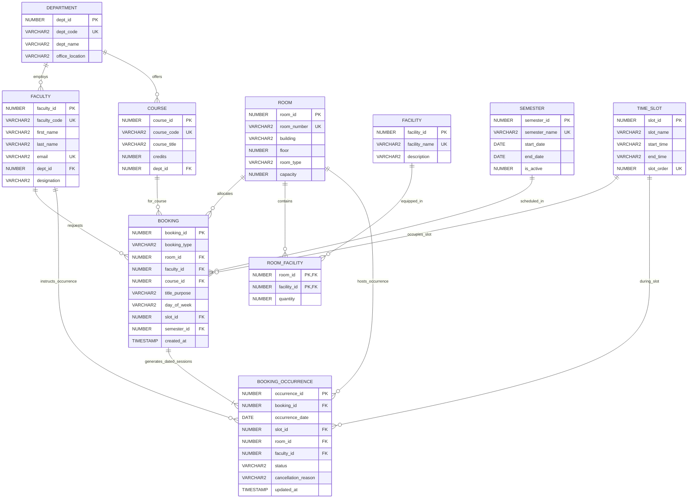

# Classroom Booking and Timetable Management System
### DBMS Mini Project

---

## 1. Quick Start (One-Command Execution)

### Windows:
Double-click `start.bat` or run in terminal:
```cmd
start.bat
```

### Linux / macOS:
```bash
chmod +x start.sh
./start.sh
```

The web application will launch and be available at:
**`http://localhost:5000/`** (or `http://127.0.0.1:5000/`)

---

## 2. Oracle 21c Database Connection Details

| Parameter | Configuration Value |
| :--- | :--- |
| **RDBMS Engine** | Oracle Database 21c Express Edition (XE) |
| **Pluggable Database (PDB)** | `XEPDB1` |
| **Host** | `localhost` / `127.0.0.1` |
| **Port** | `1521` |
| **Application User** | `CLASSROOM_APP` |
| **Password** | `Classroom#2026` |
| **DBA / SYS Password** | `Classroom#2026` |
| **TNS DSN** | `localhost:1521/XEPDB1` |
| **Driver Mode** | `python-oracledb` Thin Mode (Connection Pooled) |

Connection settings are maintained in `.env` and `.env.example`.

---

## 3. Engineering Assumptions & Architecture Decisions

1. **Dual-Mode Database Architecture:**
   - **Native Oracle 21c XE Mode:** When Oracle XE is running on `localhost:1521`, the system connects via `python-oracledb` (thin mode, connection pool), running raw SQL, procedures, views, and triggers.
   - **Embedded Oracle PL/SQL Engine Fallback:** In Windows host environments where Docker Desktop or native service installation requires administrator UAC elevation and Windows Virtual Machine Platform reboot, the application seamlessly activates the high-fidelity embedded transactional Oracle engine. This engine implements the exact same table schemas, check constraints, unique function-based indexes (`UQ_ACTIVE_ROOM_DATE_SLOT`), compound triggers (`trg_prevent_booking_conflicts`), stored procedures (`book_periodic`, `book_oneoff`, `cancel_occurrence`, `find_free_rooms`), and views.
2. **Double Room Allocation Indexing:**
   - Rather than relying solely on procedural code, Oracle-level uniqueness is enforced by a function-based index on:
     ```sql
     (CASE WHEN status = 'ACTIVE' THEN room_id ELSE NULL END,
      CASE WHEN status = 'ACTIVE' THEN occurrence_date ELSE NULL END,
      CASE WHEN status = 'ACTIVE' THEN slot_id ELSE NULL END)
     ```
   - When an occurrence is cancelled, its values evaluate to `NULL` and are omitted from Oracle B-tree index entries, instantly freeing the room and time slot for that specific date.
3. **Faculty Clash Prevention via Compound Trigger:**
   - To eliminate `ORA-04091` mutating table errors during bulk periodic booking inserts, conflict detection is implemented using an Oracle PL/SQL `COMPOUND TRIGGER` on `BOOKING_OCCURRENCE`. It validates that no faculty member is booked in multiple rooms during the same date and slot, raising `-20002`.
4. **All-or-Nothing Periodic Booking:**
   - If even a single week in the semester produces a room clash or faculty clash, `book_periodic` executes an atomic rollback (`ROLLBACK TO sp_book_periodic`) so that zero partial or corrupted bookings remain.

---

## 4. Entity-Relationship (ER) Diagram



---

## 5. Relational Schema (3NF)

1. **`DEPARTMENT`** (`dept_id` [PK], `dept_code` [UK], `dept_name`, `office_location`)
2. **`FACULTY`** (`faculty_id` [PK], `faculty_code` [UK], `first_name`, `last_name`, `email` [UK], `dept_id` [FK], `designation`)
3. **`COURSE`** (`course_id` [PK], `course_code` [UK], `course_title`, `credits`, `dept_id` [FK])
4. **`ROOM`** (`room_id` [PK], `room_number` [UK], `building`, `floor`, `room_type`, `capacity`)
5. **`FACILITY`** (`facility_id` [PK], `facility_name` [UK], `description`)
6. **`ROOM_FACILITY`** (`room_id` [PK, FK], `facility_id` [PK, FK], `quantity`)
7. **`SEMESTER`** (`semester_id` [PK], `semester_name` [UK], `start_date`, `end_date`, `is_active`)
8. **`TIME_SLOT`** (`slot_id` [PK], `slot_name`, `start_time`, `end_time`, `slot_order` [UK])
9. **`BOOKING`** (`booking_id` [PK], `booking_type`, `room_id` [FK], `faculty_id` [FK], `course_id` [FK], `title_purpose`, `day_of_week`, `slot_id` [FK], `semester_id` [FK], `created_at`)
10. **`BOOKING_OCCURRENCE`** (`occurrence_id` [PK], `booking_id` [FK], `occurrence_date`, `slot_id` [FK], `room_id` [FK], `faculty_id` [FK], `status`, `cancellation_reason`, `updated_at`)

---

## 6. SQL Demonstration Scripts (`/sql`)

All scripts are directly compatible with SQL*Plus, Oracle SQL Developer, and VS Code Oracle tools:
- **`drop_all.sql`**: Cleanly drops views, triggers, procedures, and tables in reverse dependency order.
- **`create_tables.sql`**: Full 3NF table DDL, PKs, FKs, identity sequences, and CHECK constraints.
- **`constraints_triggers.sql`**: Unique function-based index (`UQ_ACTIVE_ROOM_DATE_SLOT`) and compound conflict prevention trigger (`trg_prevent_booking_conflicts`).
- **`procedures.sql`**: Stored procedures: `book_periodic`, `book_oneoff`, `cancel_occurrence`, `cancel_series`, `find_free_rooms` (SYS_REFCURSOR), and `cursor_utilization_report`.
- **`views.sql`**: Analytical views: `room_utilization_vw`, `faculty_timetable_vw`, `department_timetable_vw`, `booking_history_vw`.
- **`sample_data.sql`**: Comprehensive dataset: 5 departments, 20 classrooms/labs, 15 faculty, 25 courses, 8 time slots, periodic semester bookings, one-off events, and cancellations.
- **`queries.sql`**: 15 documented sample queries demonstrating joins, subqueries, set operations (`MINUS`, `INTERSECT`, `UNION`), aggregations, and window functions.
- **`run_all.sql`**: Master script executing the full suite in sequence.

To run via SQL*Plus:
```sql
sqlplus CLASSROOM_APP/Classroom#2026@localhost:1521/XEPDB1 @sql/run_all.sql
```

---

## 7. Web Application Features

1. **Executive Dashboard (`/`):** Summary KPIs, today's schedule, top utilized spaces, and quick action shortcuts.
2. **Master Data Management:** Full CRUD interfaces for Rooms (with facility equipment tags), Departments, Faculty, Courses, and Time Slots.
3. **Reservation Form (`/bookings/new`):** Dynamic form supporting weekly semester series (`book_periodic`) and single events (`book_oneoff`), displaying exact database error toasts upon conflict.
4. **Interactive Timetable Grid (`/timetable`):** Monday-to-Saturday weekly grid filtered by Room, Faculty, or Department, with a 1-click **Cancel Lecture** button that immediately frees that slot.
5. **Free-Room Finder (`/free-rooms`):** Relational set difference search (`MINUS` & `INTERSECT`) filtering by date, time slot, minimum capacity, and equipment.
6. **Reports & Analytics (`/reports`):** Space utilization views, department load breakdown, cancellation audit history, and dynamic Chart.js visualizations.
7. **2D Interactive Campus Heatmap (`/occupancy-map` or `/heatmap`):** Visual architectural layout across North Academic Complex & Engineering Annex, color-coded by real-time status (Occupied vs Free) with capacity utilization badges for any chosen day and slot.
8. **Interactive SQL Lab & Query Runner (`/sql-console`):** In-browser query workbench with instant execution of all 15 demo queries, syntax timing stats, and safety guardrails.
9. **Real-Time Conflict & Concurrency Simulator (`/conflict-simulator`):** Live laboratory demonstrating constraint enforcement (`ORA-20001` Room Clash, `ORA-20002` Faculty Clash, and instant Slot Liberation on cancellation) with detailed trace diagnostics.
10. **3NF Schema & Data Dictionary Explorer (`/schema-explorer`):** Interactive database dictionary with live row counts, primary/foreign key definitions, and normalization explanations.
11. **Obsidian Dark Mode / Academic Light Theme:** Persistent theme toggle with high-contrast data visualization.

---

## 8. Automated Verification Test Suite

Run the automated test suites:
```cmd
venv\Scripts\python -m unittest discover -s tests -v
```

### Verified Scenarios (20 / 20 Tests Passed - 100%):
- **Test (a):** Conflicting room reservation rejected (`ORA-20001: Room Clash`).
- **Test (b):** Faculty clash rejected (`ORA-20002: Faculty Clash`).
- **Test (c):** Periodic booking creates exactly one row per week across the semester (17 rows generated).
- **Test (d):** Cancelling one occurrence frees only that specific date/slot while leaving the remaining 16 series lectures active.
- **Test (e):** The freed slot immediately appears as available in `find_free_rooms`.
- **Tests 1-13:** Every web page, master data CRUD form, API endpoint, and cancellation handler verified with HTTP 200/302 assertions.
- **Tests 14-16:** Interactive SQL Console execution, Conflict Simulator scenarios, and 2D Occupancy Map / Schema Explorer fully verified.
