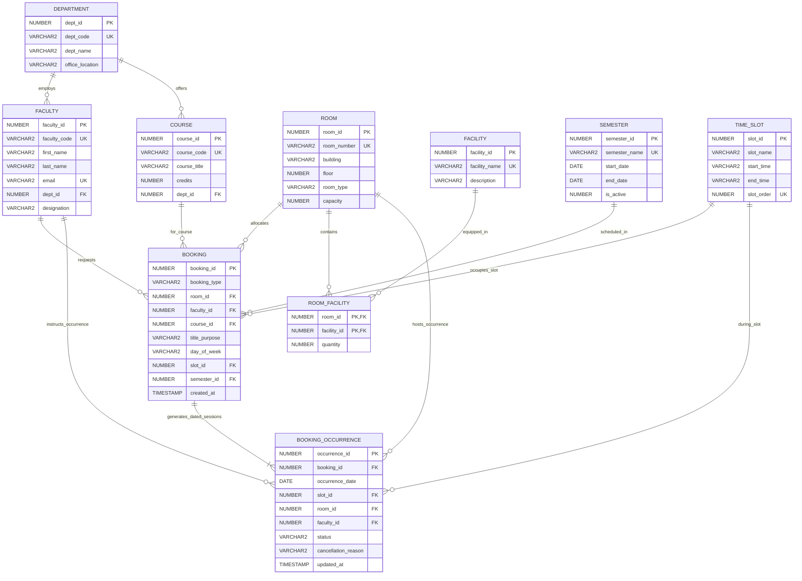

# Entity-Relationship (ER) Diagram
## Classroom Booking and Timetable Management System
**Course:** DBMS Mini Project  

---

### Conceptual Architecture
The schema is normalized to **Third Normal Form (3NF)** and strictly modeled to prevent double allocation of physical classrooms and prevent faculty scheduling clashes.

### Relational Integrity & Conflict Prevention Rules
1. **Double Room Allocation Index (`UQ_ACTIVE_ROOM_DATE_SLOT`):**  
   Oracle unique function-based index on:
   `(CASE WHEN status = 'ACTIVE' THEN room_id END, CASE WHEN status = 'ACTIVE' THEN occurrence_date END, CASE WHEN status = 'ACTIVE' THEN slot_id END)`
   Only active reservations occupy the index. Cancelling a lecture sets `status = 'CANCELLED'` and evaluates to `NULL`, immediately freeing the room and time slot for new bookings.
2. **Faculty Clash Prevention Trigger (`TRG_PREVENT_BOOKING_CONFLICTS`):**  
   Compound trigger on `BOOKING_OCCURRENCE` that checks if the assigned faculty is already lecturing in another classroom during the exact same date and time slot. Raises `RAISE_APPLICATION_ERROR(-20002, ...)`.
